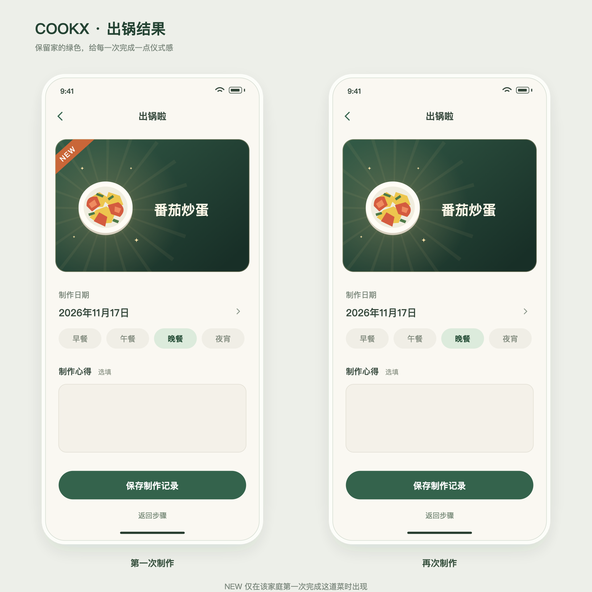

# COOKX 出锅结果设计交接

本目录保存出锅结果的最终视觉稿、已选音频、裁剪时序及原始交互规则，App 接入记录见文末。

## 交付文件

| 文件 | 用途 |
| --- | --- |
| [设计预览](cooking-result.svg.png) | 左侧首次制作，右侧再次制作 |
| [可编辑 SVG](cooking-result.svg) | 视觉稿，包含两个状态 |
| [衔接试听版](audio/cooking-result-preview.mp3) | 大成功接物品音效，约 7.60 秒 |
| [大成功裁剪片段](audio/01-cooking-great-success.wav) | 精确裁剪后的 PCM 音频，5.70 秒 |
| [物品音效裁剪片段](audio/02-get-item.wav) | 去掉前后空白，2.00 秒 |
| [素材与时序清单](handoff.json) | 音频来源、校验值、裁剪范围和播放起点 |

## 已确定的视觉内容

- 页顶标题为“出锅啦”。
- 结果卡片包含菜品图片和菜名；示例菜名为“番茄炒蛋”，实际使用对应菜谱名称。
- 卡片内不再显示“出锅啦”或“制作完成”，不显示心心。
- 第一次制作显示橙色 NEW 飘带，再次制作不显示。
- 保留 COOKX 绿色和暖白配色，图片周围使用柔和光芒。
- 卡片下方保留制作日期、餐次、选填心得与保存制作记录入口。

插画是当前项目素材的设计示例；本稿未扩展拍照或图片上传流程。图中文字、光芒、边框和 NEW 应独立呈现，不能把整张手机设计图直接用作 App 背景。

## 制作记录与 NEW

已确定：NEW 表示第一次制作，菜谱和制作记录归属家庭。

实现判断方案：查询当前家庭中对应菜谱的已保存制作记录。没有记录时展示 NEW，有至少一条记录时不展示。按家庭和菜谱的稳定标识判断，不按菜名判断，也不按是否打开过详情或完成页判断。

| 场景 | 预期行为 |
| --- | --- |
| 首次进入这道菜的完成页，尚无历史记录 | 展示 NEW，不自动生成制作记录 |
| 返回步骤后再进入，期间未保存 | NEW 状态不因页面往返而改变 |
| 第一次保存成功 | 生成本次制作记录，下次制作不再显示 NEW |
| 保存失败 | 保留表单内容与 NEW，允许重试 |
| 已做过同名的另一道菜 | 不影响当前菜谱的 NEW 状态 |
| 其他家庭做过这道菜 | 不影响当前家庭的 NEW 状态 |

制作时间沿用既定规则：开始制作时按设备本地时间预选日期和餐次，只在完成页展示设置；返回步骤、跨时段或页面重建均不自动覆盖已选值。保存操作沿用现有流程，避免连续点击造成重复记录。

## 已确定的音频顺序与裁剪

使用《王国之泪》OST 第 9 碟的两段音频，顺序为 **第 41 轨料理大成功 → 第 31 轨获得物品**。用户允许物品音效在大成功文件末尾的静音区开始，不必等到原文件结束。

本版裁剪和衔接如下，时间均从已解码音频起点计算：

| 片段 | 原文件保留范围 | 裁剪后时长 | 在完成音效中的起点 |
| --- | --- | --- | --- |
| 料理大成功 | 0.00–5.70 秒 | 5.70 秒 | 0.00 秒 |
| 获得物品 | 0.55–2.55 秒 | 2.00 秒 | 5.60 秒 |

两文件在时间线上重叠 0.10 秒，重叠发生在大成功结尾的近静音区。检测阈值为 −60 dB、最短持续时间 0.15 秒：大成功末尾近静音约从 5.600 秒开始；物品音效开头近静音约至 0.572 秒，末尾约从 2.450 秒开始。裁剪点留有余量，未做响度归一化、变速或变调。

[衔接试听版](audio/cooking-result-preview.mp3)是此时序的直接混合结果，方便评审。后续可以直接使用整合音频避免双播放器调度误差；如使用两个独立片段，应按此时序播放，不能等待第一段 5.70 秒结束后才启动第二段。最终听感可在试听后继续微调。

## 播放交互建议

以下是后续实现建议，尚未作为单独确认的产品规则：

- 同一次制作首次进入完成页时触发一次完整音频序列，首次制作和再次制作均可触发；不将音频与 NEW 绑定。
- 表单编辑、日期餐次切换、重组、页面重建、返回步骤再进入时不重复触发。
- 保存不等待音效结束；用户保存、离开完成页或切到后台时停止播放，清理未开始的第二段。
- 音频加载或播放失败不阻碍记录保存；音量遵循设备设置，不强行提高音量。

不要把音频播放完成当作制作记录已保存，也不要根据是否播放过音效决定 NEW。

## 页面导航的对接

设计稿中的“返回步骤”表示回看制作步骤的入口。项目既有方案为完成页保留“上一页／计时器／下一页”固定底栏，并禁用下一页。后续实现需确定采用哪种呈现，不应同时叠加两套返回入口；本轮未改动既有底栏规则。

## 来源与原文件

- [原始料理大成功 MP3](../../references/zelda-totk-cooking/cooking-great-success.mp3) · [下载页面](https://downloads.khinsider.com/game-soundtracks/album/the-legend-of-zelda-tears-of-the-kingdom-original-soundtrack-2024/9-41.%2520Major%2520Cooking%2520Success.mp3)
- [原始获得物品 MP3](../../references/zelda-totk-cooking/get-fanfare-item.mp3) · [用户指定下载页面](https://downloads.khinsider.com/game-soundtracks/album/the-legend-of-zelda-tears-of-the-kingdom-original-soundtrack-2024/9-31.%2520Get%2520Fanfare%2520%2528Item%2529.mp3)
- [官方曲目目录](https://columbia.jp/zelda/)核对曲名与编号；实际音频文件来自第三方 KHInsider 收集站。
- [先前收集的画面与音效资料](../../references/zelda-totk-cooking/README.md)保留参考来源，普通成功音效仅作为历史对照，不是本次选用音效。

游戏原声音频不属于 COOKX 自有素材。

## 后续验收

- 首次与再次制作分别对应两张状态稿，页面文案没有重复，没有心心。
- 更换菜谱名称和图片时显示正确，长菜名与大字体不遮挡 NEW 或表单。
- NEW 按家庭和菜谱记录判断，保存失败不丢失输入，成功后再次制作不再显示。
- 音频按 0.00 秒和 5.60 秒起点衔接，没有等待原文件静音结束的停顿，也不因页面往返重复播放。
- 返回、后台、保存及播放失败场景按最终确认的播放规则验证。
- 系统栏、键盘、小屏滚动和深色模式在实际设备上检查；本稿为静态视觉稿，不等同于设备验证。

## App 接入记录（2026-11-17）

本交接稿的视觉及整合音频现已接入 App。采用按家庭＋菜谱稳定 ID 查询保存记录的 NEW 判断；保留既有固定底栏，不增加“返回步骤”。音频资源复制自本目录衔接试听版，同一制作会话首次进入完成页时播放一次，离开、保存或后台时释放播放器，页面重建及往返不重播。原交接建议中的这些方案在本次实现中采用，其他历史讨论不自动扩展为需求。
