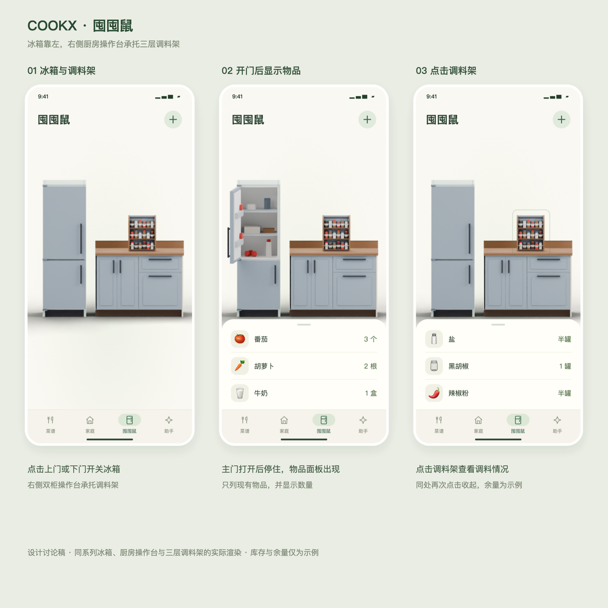

# 囤囤鼠冰箱交互设计

本轮使用用户已选的 fridge doors 冰箱与同系列三层调料架，按“冰箱靠左、右侧厨房操作台承托调料架”更新囤囤鼠设计。用户已同意长条厨房操作台方向，本稿取同系列 Counter and cabinet modules 的两组柜体与对应台面。点击冰箱播放开门动画，点击调料架查看调料信息。交付的是可交互设计原型和视觉稿，未修改 Android App。

## 查看设计

- [场景、冰箱与调料三状态对照图](pantry-fridge-design.svg.png)
- [可编辑对照图 SVG](pantry-fridge-design.svg)
- [可交互原型](prototype.html)：用浏览器打开，点击冰箱体验开门、物品列表、物品信息和登记物品；无需联网或构建 App。
- 单页截图：[关门](screen-closed.png)、[开门与物品列表](screen-open.png)、[物品信息](screen-item.png)、[空列表](screen-empty.png)、[调料列表](screen-spices.png)。

原型中番茄 3 个、胡萝卜 2 根、牛奶 1 盒及盐半罐、黑胡椒 1 罐、辣椒粉半罐均为示例；鸡蛋为没有库存的隐藏示例。变化仅在当前网页内存中生效，刷新后恢复演示数据。顶部加号是登记物品入口，底部其他导航项只呈现位置，不模拟其他页面。

## 用户已确定的方向

- 使用 [Oven and fridge doors](https://1designtool.com/3d/models/kitchen-oven-and-fridge-doors) 冰箱素材。
- 固定正面第一人称视角，点击冰箱后播放开门动画。
- 使用与冰箱同属 Kitchen 系列的三层 Spice racks；冰箱在画面靠左，右边放厨房操作台，台面承托调料架。
- 调料架作为点击查看调料情况的入口。
- 开门后 UI 显示物品信息；只显示现有物品，并显示每项数量，不显示没有库存的物品。
- 点击上门或下门触发相同的打开动作，再点同一处关闭；不另设打开或关闭按钮。
- 移除“家中物品”标题，面板直接展示物品。

以下布局、动作时长与附加交互属于本轮设计方案，供评审，不自动扩展库存业务规则。

## 状态与交互方案

| 状态 | 视觉和操作 |
| --- | --- |
| 关门 | 冰箱为主体；点击冰箱上门或下门均触发同一个打开动作；打开后同一点击区域可再次关闭，不另设开关按钮 |
| 调料 | 点击整个三层调料架显示调料示例列表；再次点击收起。与冰箱面板互斥，从冰箱切换时先关闭门。调料数据与冰箱数据在演示中分开，正式储藏位置规则尚未确定 |
| 开门中 | 约 0.85 秒，主门向外转到约 100 度，下方冷冻门保持关闭；合并重复点击，暂不展示物品面板 |
| 打开 | 门停留在打开位置，底部精简面板向上出现；无标题，直接展示现有物品与数量，保留可点击的冰箱区域和底部导航 |
| 查看物品 | 列表显示名称和数量，如“番茄 · 3 个”；没有库存的物品不列出，点击名称进入对应信息面板 |
| 物品信息 | 展示物品名称及数量，不再显示“已有／暂时没有”的切换按钮 |
| 登记 | 顶部加号打开名称与数量输入，数量暂采用自由文本；登记后展示列表，冰箱尚未打开时先播放开门动画。表单仅演示，不写入 App |
| 关门 | 再次点击冰箱同一位置收起面板并反向关闭门；不清空记录、不改变物品数量 |
| 空列表 | 打开冰箱后展示“还没有物品”和登记入口，避免把模型里的装饰食物当成已有记录 |

物品面板不是新页面：进入物品信息后可返回原列表，不重新播放开门动画。上下门统一作为同一个开关区域；精简面板后，上下门常用点击位置仍可触达，列表操作不会被冰箱点击区域截获。

点击调料架整架作为入口，不把模型中的十八罐逐个映射为库存。调料面板暂沿用名称＋自由文本余量，点击同处收起；这些细节是本轮演示方案，尚未由用户单独确认。示例调料不会写入 App。

原型包含减弱动态效果处理；浏览器设置减少动态效果时缩短动作过程。原型的 Escape 行为依次为关闭登记弹窗、返回物品列表、关闭冰箱或收起调料列表；Android 系统返回与页面离开后的状态恢复规则在实现前确认。

## 显示哪些物品信息

用户已确认本版显示 **名称＋现有数量**，并隐藏没有库存的物品。数量和单位可先用自由文本表达，例如“3 个”“半盒”；具体计量与维护规则仍待设计。价格、采购日期、保质期和冷藏冷冻分区不在本版展示范围。

当前 App 数据只有名称和是否已有，没有数量字段。本轮只更新设计；示例数量不得反写为真实数据。实现时需要另行补充数量录入与存储方案，不能为旧条目凭空生成数量。缺失数量的设计兜底为“未填数量”，不把缺失值当成零；原型中明确为零的登记值不会列出。

面板已按用户要求去掉标题；当前数据没有储藏位置，不将所有记录自动认定为实际存放在冰箱内。是否区分冰箱、冷冻、调料台等位置继续讨论。

登记及数量只是在原型中演示，不接入真实家庭数据。模型预置食物是装饰，不与物品列表逐项对应，不应在实际产品中当作真实库存数量或可点击物品。若后续要求直接点 3D 食材，需要先将食物几何从机身分离，并明确数据映射。

## 视觉与动画素材

- 沿用 COOKX 绿色交互色和暖白背景，模型采用实际源资产渲染；未用 AI 图片替代所选模型。
- 冰箱源模型包含烤箱和柜体，本稿隐藏这些部件；下方冷冻门保持关闭。另导入同系列 Spice racks 和 Counter and cabinet modules。操作台保留右侧 `module_3`、`module_4`，隐藏左侧柜体、水槽及原始台面杂物。
- 操作台按源模型原比例保留右侧约 1.23 m 宽、0.624 m 深的两组柜体；台面高 0.90 m，后挡水边高约 1.00 m。沿原模型 x=0 截断柜体与台面，封闭切边并补同材质左侧端板；排除水槽所在的左半段，因此没有把整个模型压扁，也没有留下水槽孔。未新增炉灶。
- 调料架保留原尺寸约 0.384 × 0.098 × 0.496 m，底部置于台面 z=0.90 m。场景在同一镜头下渲染，操作台与冰箱均落地。柜体保留范围、具体长度和去掉水槽是本轮适配方案。
- `frames/00.png` 至 `frames/19.png` 是同一镜头下冰箱、厨房操作台和调料架的透明合成场景渲染帧，包含地面接触阴影；仅冰箱主门变化：关门为 0 度，完全打开为约 100 度。原型通过这 20 帧演示点击开门，不直接循环播放上游 8 秒动画。
- 这些帧用于设计预览，不代表 Android 已选定逐帧动画；后续可选择实时 3D 或预渲染方式，只需保持固定镜头、门轴、打开后停住及物品面板的节奏。
- 上游许可允许在项目中使用、修改和渲染，但不允许单独再分发源模型；源 GLB 未复制进本交付目录。下载入口与说明见[已核对的素材记录](../../references/pantry-fridge/single-door/README.md)。

## 实现前仍需确认

1. 面板采用本稿的底部浮层，还是打开后进入独立库存页。
2. 数量采用哪些录入与存储字段、缺失数量如何补录、修改数量如何保存与反馈失败。
3. 返回键、切换导航和重进囤囤鼠时，冰箱及物品面板如何恢复。
4. 3D 食物是否仅装饰，以及后续是否区分具体储藏位置。

## 本轮核验

在独立的 Microsoft Edge 无头浏览器中核验：调料架点击与同处收起、冰箱和调料之间切换、演示列表分离、上门和下门分别在同一位置点开／点关、动作完成后显示物品、数量列表与物品信息、隐藏无库存物品、无重复标题及独立按钮、登记数量、空列表与 360 像素窄屏，无运行时异常。已查看渲染帧、主要页面截图及对照图。

这是独立浏览器设计原型，没有完成 Android 编译、设备系统栏、软键盘、无障碍或 3D 性能验证，也没有写入实际库存。

操作台及架子出处、文件结构与许可见[素材清单](../../references/pantry-spice-rack/README.md)；相机投影下的场景范围见 [scene-layout.json](scene-layout.json)。原型中的点击区域随画面尺寸缩放，无独立“打开”按钮。
