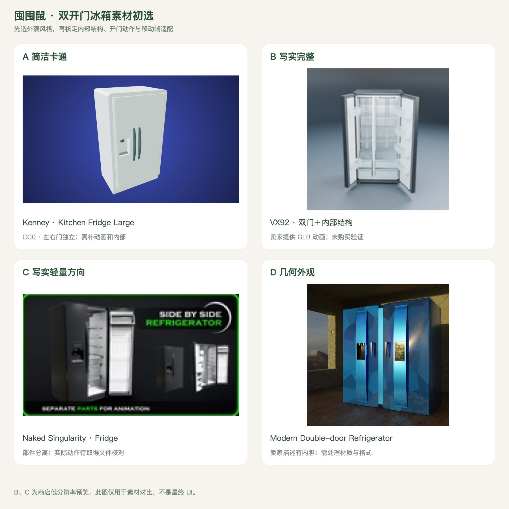
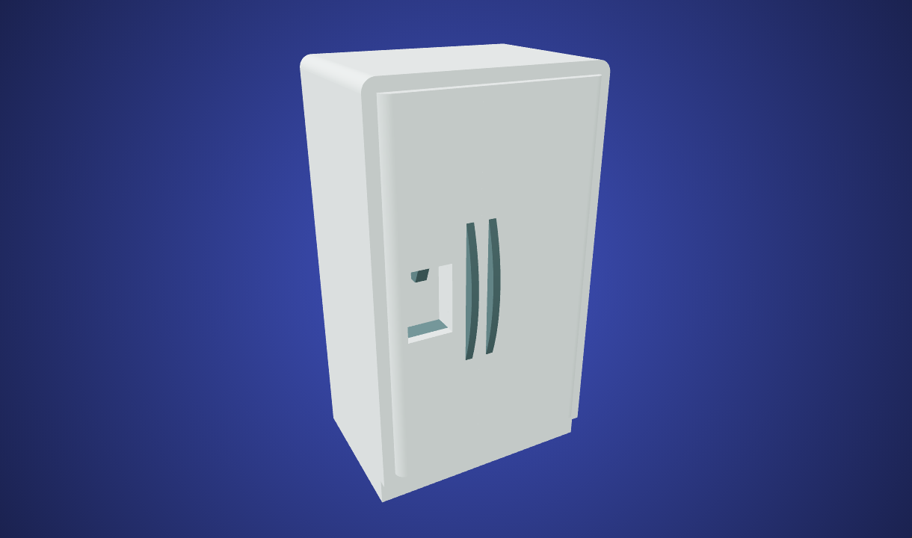
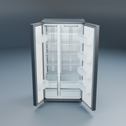
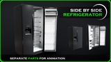
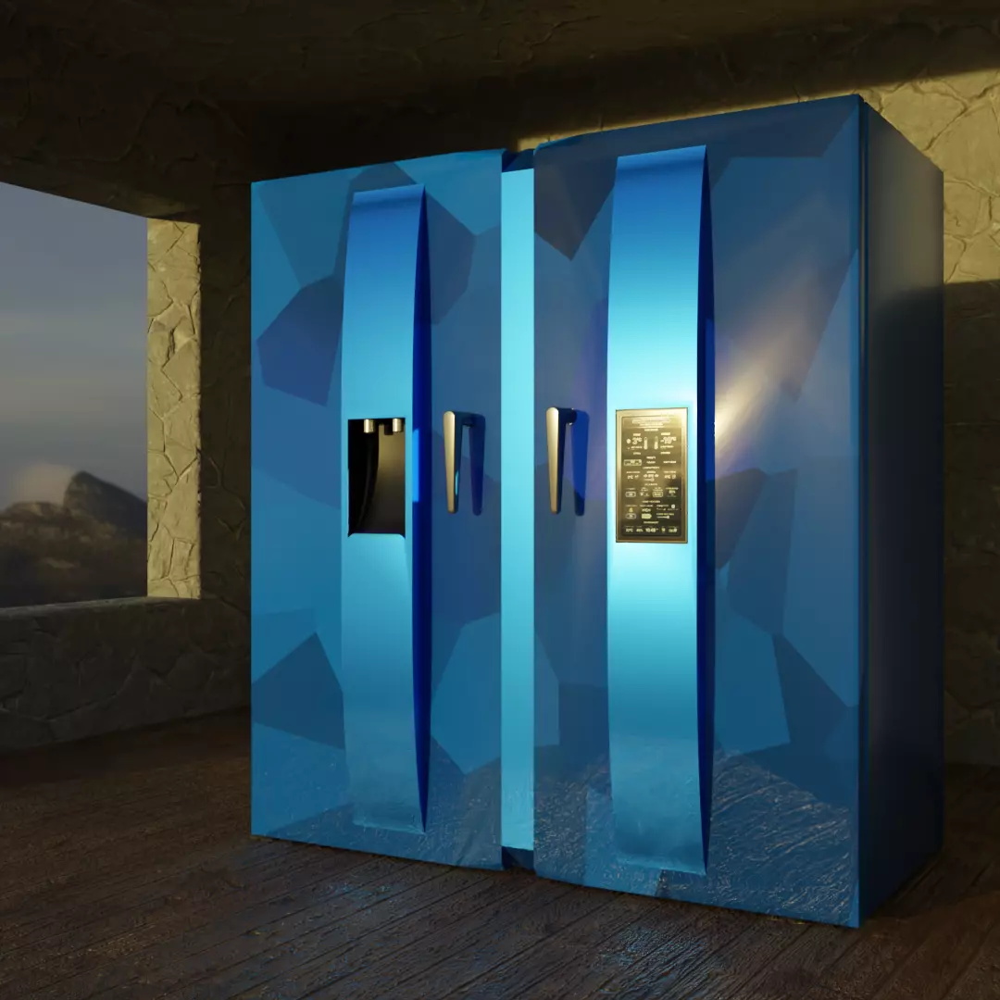
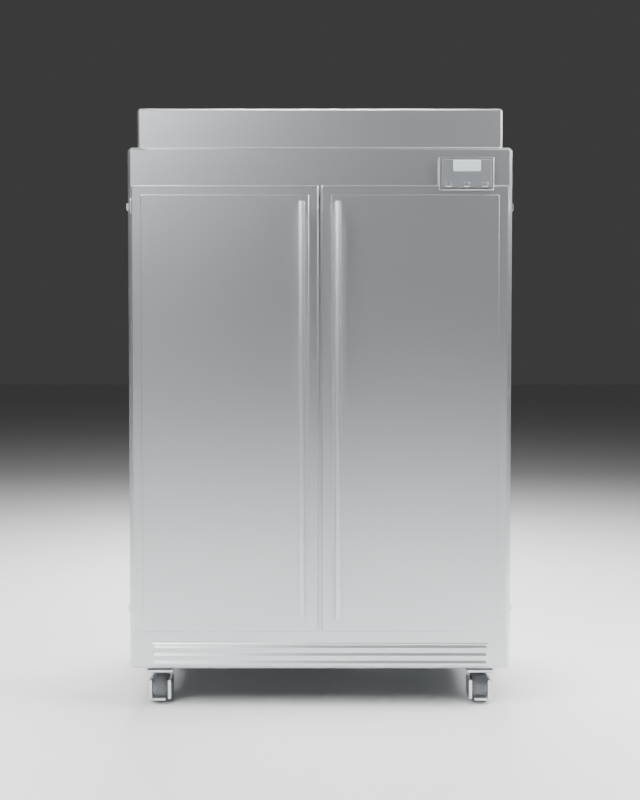
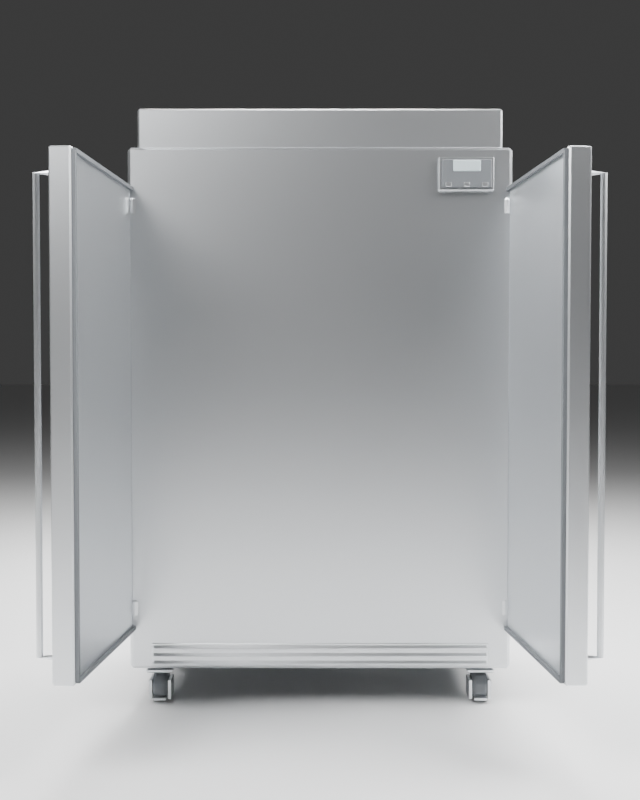

# 囤囤鼠双开门冰箱素材初选

收集日期：2026-11-17。目标是第一人称站在左右对开的双门冰箱前，点击后播放两扇门向外打开的动画，作为囤囤鼠的界面入口。用户希望先看素材再选风格；本轮不确定最终风格、不购买付费模型、不修改 App 代码。

## 优先候选

### A Kenney 简洁卡通

[Kitchen Fridge Large 来源页](https://poly.pizza/m/McgsrFB5x6) · [本地 GLB](kenney.glb)

- 来源页标注 CC0，提供 OBJ／glTF。
- 实际下载的 GLB 为 38,556 字节、584 个三角形、4 个网格，包含 `doorLeft` 和 `doorRight` 两个独立门节点，没有动画片段。
- 优点是轮廓简洁、容易配合 COOKX 的配色；这是视觉适配判断，不是已选风格。
- 还需要补开合动画，并核对门的铰链轴、内胆和层板。独立门节点不等于已经完成可用的门轴与动画，不能按“开箱即用”验收。

### B VX92 写实完整

[VX92 来源页](https://www.fab.com/listings/7feeb440-1c0e-41c7-9af7-fb586cb213ba?lang=en)

- 卖家说明提供带动画的 GLB／FBX、Blender 源文件、双门、内部结构与抽屉。
- 卖家列出 LOD0 为 40,344 三角形、14 个材质和 18 个动画片段。低层级模型没有动画片段，不能简单替换后假定动画仍在。
- 是功能匹配度较高的候选；模型尚未购买或下载，移动端实际性能、材质和动作未验证。商店低分辨率图只能看结构，精细外观需在来源页确认。
- 价格与最终购买许可未取得，不报价、不自动购买。

### C Naked Singularity 写实轻量方向

[Fridge 来源页](https://www.fab.com/listings/c054c6f7-8cf6-4182-a9d6-4cf809b27f97)

- 卖家说明左右对开、部件分离，提供 Blender／FBX；展示了内部结构。卖家也提醒所带动画主要用于预览。
- 可作为双门和内部布局的制作基础，是否可直接复用动画需取得源文件再核对。用于移动端前还需转换成选定格式并处理纹理。
- 未购买或下载模型，实际面数、门轴、动画片段与许可档位未验证。

### D 几何外观方向

[Modern Double-door Refrigerator 来源页](https://www.cgtrader.com/3d-models/electronics/other/modern-double-door-refrigerator)

- 卖家描述包括双门、内部层架、独立门网格及门轴，材质为 Blender 程序化材质。
- 适合比较更有个性的几何外观；不代表蓝色或这种材质已被选为 COOKX 风格。
- 未下载源模型。实际内部结构和门轴未验证，没有将其认定为已有完整开门动画；移动端需要烘焙或重做程序化材质。
- 价格与适用许可未核定。

## 已下载但不作为完整候选的参考

### 商用双门冰箱 动画可用但缺少内部

[来源页](https://3dassets.dev/assets/restaurant-kitchen-and-dining-upright-fridge-double-06328b60) · [本地 GLB](fridge-double.glb) · [发布者技术说明](https://3dassets.dev/assets/restaurant-kitchen-and-dining-upright-fridge-double-06328b60.md)

发布者声明 CC0。实际文件 131,972 字节、2,766 个三角形；`open` 和 `close` 动画都同时驱动 `door-left` 与 `door-right`。已在 Blender 导入并渲染正面关门与开门状态。

**实际开门后仍是一整块封闭面，没有可用内胆或层架。** 因此只能作为双门动作和比例参考，不能直接承接冰箱内食材展示。

另存的 [左门打开变体](fridge-open-left.glb)只有右门动画通道，左门是固定打开的几何状态，不能将它误认为双门同时开合的完整资产。

### Quaternius 上下门冰箱

[来源页](https://poly.pizza/m/8sjRm8fnHh) · [本地 GLB](quaternius.glb)

来源页声明 CC0。实际文件 17,360 字节、404 个三角形、单网格、无动画；外观是上下分门，未满足用户要求的左右对开。只保留为低多边形风格参考。

## 囤囤鼠界面建议

已确定的方向是固定在冰箱正前方的第一人称视角，点击后两扇门打开。以下是设计建议，尚未作为已确认的交互规则：

1. **关门状态**：冰箱作为主体，保持简洁环境和稳定镜头，整台冰箱作为点击区域，不要求用户精确点中把手。
2. **开门过程**：两门沿外侧铰链向外旋转；同时缓慢出现内部灯光，避免相机突然移动。动画期间合并重复点击，避免动作抖动。
3. **打开状态**：可看到层架和食材；点击已有食材进入信息或管理入口。食材模型作为视觉呈现，不凭画面推断实际数量。
4. **关闭与返回**：需继续讨论是点击门、点关闭入口，还是返回键关闭。动画反向播放须能回到完全关闭状态。

冰箱展示不会自动扣库存、添加采购花费或生成制作记录。食材管理的数量精度、储藏分区、食物摆放和新增入口仍需另行讨论，不因模型左右两侧布局就替产品确定“左冷冻、右冷藏”等规则。

## 素材验收要点

- 真正左右对开，机身、左门、右门分开；门轴位于外侧铰链，开门不绕模型中心旋转。
- 正面近距离能看到内胆、层板、门内侧；打开后不能是封闭实心面。
- 能稳定停留在关门和开门状态，能反向关闭，不只是一段不可交互的宣传视频。
- 竖屏要留出两门打开后的空间，门片不能穿过相机或遮住主要库存入口。
- 食材可单独增删，不能把预置食物烘焙成永远存在的库存。
- 在最终 Android 渲染方案和设备上验证体积、纹理、透明层架与流畅度；本轮不选择技术栈，也不把网格较少直接等同于运行流畅。

## 核对范围

A 和两个免费参考模型已下载并检查 GLB 结构；商用双门参考已进行静态帧渲染。B、C、D 为来源页与预览图核对，未购买源文件。所有模型都未在 Android 上验证。发布者提供的许可信息与模型来源、下载地址、文件大小、校验值见 [sources.json](sources.json)，几何与动画结构检查见 [model-inspection.json](model-inspection.json)。

## 免费单侧开门冰箱补充

用户接受单侧开门后，已补充[免费可开门冰箱清单](single-door/README.md)，其中两款检查了真实动画并渲染开门状态。
