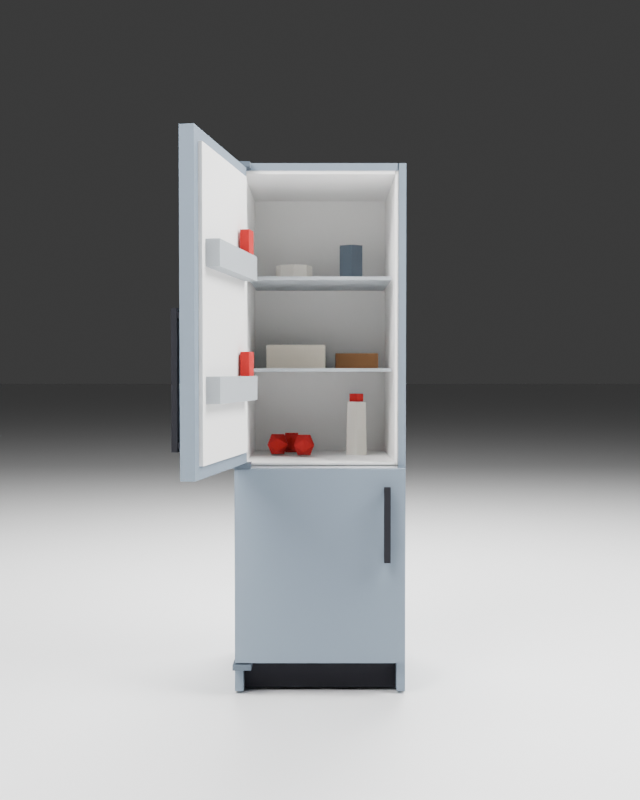
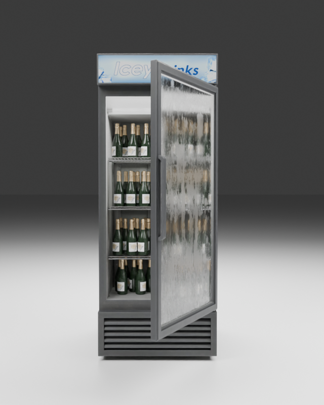
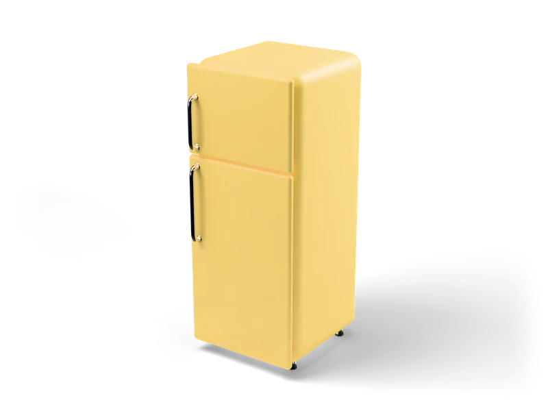
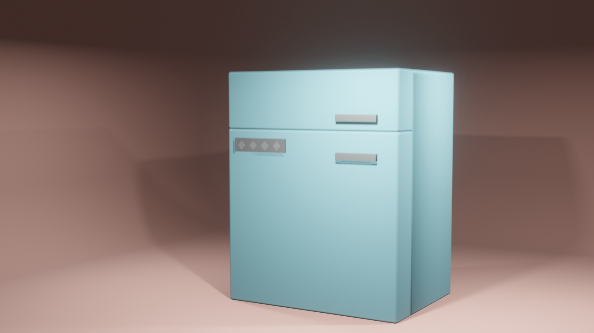

# 免费可开门冰箱素材

2026-11-17。用户接受单侧开门的家用冰箱，不再要求左右对开；继续要求免费和可开门。本轮仅收集与核对素材，不修改 App。

## 优先看这款 家用低多边形冰箱

[Oven and fridge doors 来源页](https://1designtool.com/3d/models/kitchen-oven-and-fridge-doors)

- 发布者允许免费用于个人及商业项目，无需注册或署名；不允许将源文件单独再分发或打包为模型库，因此源 GLB 仅下载至本机研究目录，不提交仓库。
- 实际下载的 GLB 为 132,008 字节，包含 `fridge_door`、`freezer_door` 和 8 秒的 `scene-motion` 动画。已在 Blender 导入并渲染，确认主门能打开，内部有层板、门内储物槽和预置食物。
- 原资源还带烤箱和柜体。图中仅为检查冰箱而隐藏了这些部件，没有改写源 GLB。
- 动画是循环展示，并非现成的点击开关逻辑；初始帧主门已打开，其他时段会打开下方冷冻门。用于 UI 时需提取目标门的开关区间、设置关闭初态，不能直接自动循环播放整段。
- 家庭界面仍需调整颜色、镜头和食物。预置食物只是装饰，不能当成用户真实库存。

[另一个动画时刻 冷冻门打开](kitchen-freezer-open.png) · [下载地址](https://assets.stoicsoft.com/1designtool/3d/models/kitchen-oven-and-fridge-doors/077490a3a8/model.glb) · [实际动画结构检查](kitchen-animation-inspection.json)

## 已确认开门的单门冷柜

[Commercial Refrigerator 来源与授权](https://github.com/KhronosGroup/glTF-Sample-Assets/blob/main/Models/CommercialRefrigerator/README.md) · [交互查看](https://github.khronos.org/glTF-Sample-Viewer-Release/?model=https://raw.githubusercontent.com/KhronosGroup/glTF-Sample-Assets/main/Models/CommercialRefrigerator/glTF-Binary/CommercialRefrigerator.glb) · [本地 GLB](commercial-fridge.glb)

- 免费，CC BY 4.0，需要保留署名。基于 Sean Thomas 的 Commercial Fridge，由 Eric Chadwick／Darmstadt Graphics Group 改进；完整出处见 [署名记录](ATTRIBUTION.md)及[上游说明快照](commercial-source.md)。
- 实际文件 10,131,180 字节，有一个针对 `FridgeDoor` 旋转的动画，约 4.67 秒。已用 Blender 导入并渲染关门和开门时刻，内部层架和瓶子可见。
- 造型是商用玻璃门冷柜，不是家用冰箱；如果选它，需要改造外观和替换预置酒瓶。
- 玻璃透射材质较复杂，体积也较大；未在 Android 上验证。它更适合验证“真正能开门、有内部”的结构和动作。

[关门状态](commercial-front-closed.png) · [结构检查](commercial-fridge-inspection.json)

## 可补动画的黄色复古款

[Grab3D Refrigerator 来源页](https://grab3d.com/models/food/refrigerator/) · [本地 GLB](retro-fridge.glb) · [许可文件](retro-LICENSE.txt)

来源标注免费 CC0，无需注册。实际下载文件 1,470,356 字节，主门、冷冻门是独立节点，但 **没有现成动画片段**。发布者描述有内胆、层板和门轴；本轮未对它执行开门渲染，因此只归入需要补动画并验证内部的候选，不称为已验证的动画冰箱。

## 其他免费动画候选

[BlendSwap Animated Fridge](https://blendswap.com/blend/28297)，作者 jsa68，页面标注 CC0、低多边形动画冰箱，Blender 2.9 制作。

下载入口显示需要登录。当前只取得作者预览和页面信息，尚未下载 .blend 或核验动画内容，不能保证它的内胆和开门方式符合界面要求。

## 核对范围

前两款已经检查实际动画文件，并用 Blender 5.2.3 渲染；黄色复古款检查了节点和动画数量；BlendSwap 仅核对页面。均未接入 COOKX，未验证点击交互、移动端性能或真实库存展示。

相关源页面、下载地址、许可和文件校验值见 [sources.json](sources.json)。本次结果补充到[之前的双门素材清单](../README.md)，并未替用户选定最终风格。
