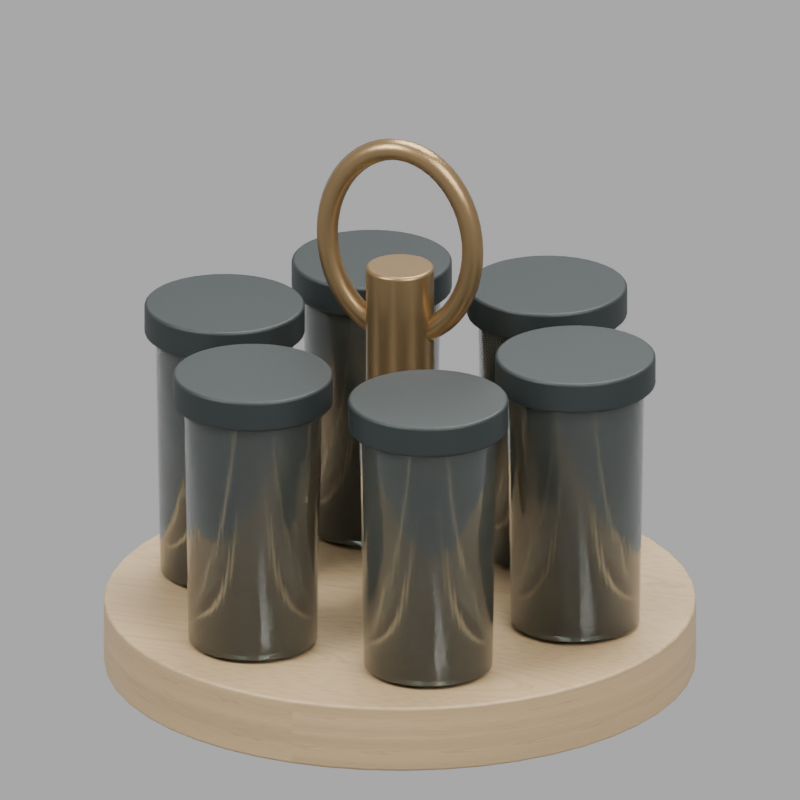
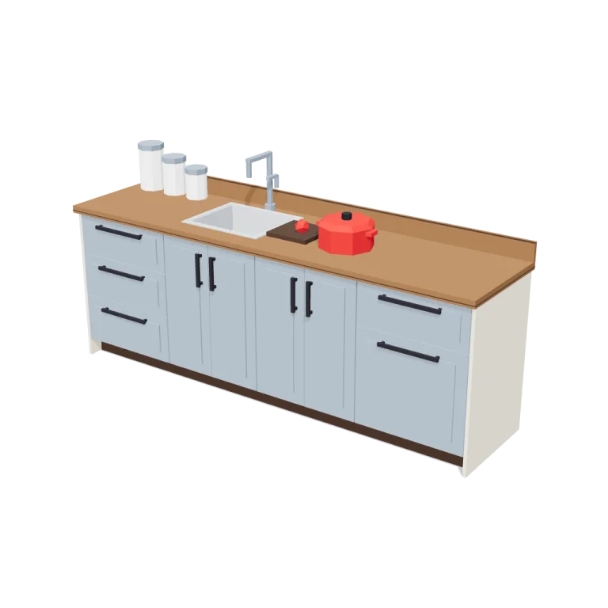
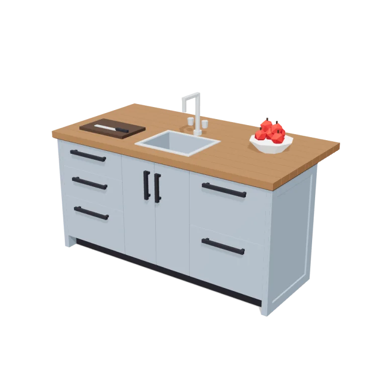

# 三层调料架与配套调料罐素材

2026-11-17。为囤囤鼠搜集放在冰箱旁边的三层调料架，点击查看调料情况。免费优先；本轮只整理素材，不修改 App 或已有冰箱设计稿。历史曾选定 A；最新设计已按用户要求移除独立架子，完整使用方案 1 操作台，详见末节。

## A：历史候选，同冰箱系列的三层架

[Spice racks 来源与在线预览](https://1designtool.com/3d/models/kitchen-spice-racks) · [GLB 下载](https://assets.stoicsoft.com/1designtool/3d/models/kitchen-spice-racks/507a7244aa/model.glb) · [许可](https://1designtool.com/3d/license)

- 和已选的 Oven and fridge doors 同属 1DesignTool Kitchen 系列，使用同一命名色板；风格最容易配套。
- 实际文件 209,220 字节、2,564 三角面、27 网格；三层，每层六罐，共十八罐；无动画。约宽 38、高 50、深 10 cm。
- 免费用于个人及商业 App，可修改、拆分和制作渲染，无需署名。禁止将源模型单独再分发，因此原 GLB 仅下载至本机研究目录，不放入仓库。
- 罐子已经配套，但按 `jars_1`／`jars_2`／`jars_3` 分组，再按材质合并；**不是十八个独立罐对象**。整个架子作为点击入口可以使用；若逐罐控制、隐藏或取出，需要先拆分几何或另外制作独立罐。白色标签是无文字色带。
- 架子默认是台面摆放或挂墙尺度；放在冰箱旁，建议挂墙或放在小台面上。小台面是设计建议，不是模型自带部件或已确认需求。

## B：写实备选，木制三层阶梯架＋整套罐子

[Wood Spice Rack and Spices](https://www.blendkit.com/asset-gallery-detail/a3f3affb-1549-486a-bbfc-ba516709ef5a/) · [发布平台许可](https://www.blendkit.com/docs/licenses/)

- 作者 Doug Teeples。页面标注 Free、Royalty free；预览能看到三层阶梯架、配套玻璃罐、散放罐及盖子。
- 页面标注约 20.9 MiB、949,158 多边形，明显比 A 重；若采用，建议离线渲染或先减面。写实木纹、玻璃和英文标签也需要与现有冰箱风格协调。
- 尚未下载源文件；罐子能否逐个拆分、实际文件格式与移动端效果尚未验证。Free 不等于 CC0，不将其作为可自由再分发的模型库资源。下载按平台 Get this model 流程办理，本轮未登录或安装插件。

## C：独立调料罐补充素材

[Spice Turn - Kitchen Organizer](https://www.innerscene.com/tools/library/3d-parts/spice-turn-kitchen-organizer-7697fde2) · [本地 GLB](spice-carousel.glb) · [许可记录](spice-carousel-LICENSE.txt)

- Innerscene 原创，CC0，免费商用、修改与再分发，无需署名。
- 本体是**单层圆形六罐托盘**，不能代替三层架；主要作为独立罐的备选。实际文件 917,480 字节，罐身、底部、盖子分别命名为独立节点，可组合成单罐。
- 罐子是空罐，内容物、标签、颜色需要另做。与 A 并非同系列，需统一材质和尺寸，尚未做替换组合。
- 已导入 Blender 并渲染检查；透明玻璃的表现依赖环境、材质与渲染器，尚未做 Android 验证。

## 排除的另一款

[tabitown 的 Spice Rack](https://sketchfab.com/3d-models/spice-rack-9b5633559e414cfba5fc055c53cc298b) 免费、CC BY 4.0，需署名。原作者预览是两排球形瓶＋抽屉，并非三层，因此不列入推荐。仅检查公开元数据及[作者预览](sketchfab-spice-rack.jpg)，未下载源文件。

## 历史设计方向（已被完整操作台方案替代）

- 用户已确定选用 A：同系列三层调料架。冰箱靠左，右侧落地桌承托调料架，点击查看调料情况。
- 本轮设计稿采用 A 自带罐子作装饰、整个架子作为入口；调料余量与退出方式仍属于演示方案，正式规则待确认。
- 模型里的十八罐不是家庭实际库存，不据此创建调料记录或推算剩余量；没有现货的调料是否在架上隐藏仍待讨论。
- 本轮没有修改 App、库存数据、冰箱交互或上次设计稿。

[候选对比图](comparison.svg.png) · [出处清单](sources.json) · [实际文件结构与校验值](model-inspection.json)。A、C 已检查实际文件并在 Blender 5.2.3 渲染；B 仅检查来源页与预览。未做 Android 设备或性能验证。

## 同系列落地桌／台柜补充（2026-11-17）

用户要求同系列落地桌，放在冰箱右侧，桌面放三层调料架；冰箱在画面靠左。已核对 Kitchen 系列三款：

| 素材 | 类型与核验 | 本稿处理 |
| --- | --- | --- |
| [Breakfast nook](https://1designtool.com/3d/models/kitchen-breakfast-nook) | 早餐角组合，含独立 `table` 节点、木桌面和黑色落地底座。下载 GLB 134,260 字节；已导入并渲染桌子 | 优先用于本轮摆放预览，隐藏座椅、长椅与餐具，桌宽深缩至约 0.638 × 0.52 m，高度仍为 0.75 m |
| [Counter and cabinet modules](https://1designtool.com/3d/models/kitchen-counter-and-cabinet-modules) | 落地橱柜台面组合，四组柜体与水槽，约 2.46 m 宽；实际 GLB 115,584 字节，已核对节点 | 更适合台柜方向；原文件较长，不作为现成小桌直接使用，尚未拆分渲染 |
| [Island](https://1designtool.com/3d/models/kitchen-island) | 独立岛台，含柜体、水槽和吧台延伸；实际 GLB 152,364 字节，已核对节点 | 不如独立木桌简洁，本稿未采用 |

三款均同属 Kitchen 系列，沿用 [1DesignTool 库许可](https://1designtool.com/3d/license)：允许免费个人／商业项目使用与修改，无需署名，禁止独立再分发源模型。本轮源 GLB 只存本机研究目录，仓库交付项目渲染与检查记录。木桌的具体选型与缩放是设计方案，用户已确认的是位置关系及同系列调料架。

[场景设计稿](../../designs/pantry-fridge/README.md)已更新，可预览冰箱在左、桌与架在右以及两个点击入口。

## 更大的厨房操作台候选（2026-11-17）

用户希望比小木桌更大，类似厨房煮饭台；继续保留冰箱在左、调料架在右侧台面上的关系。用户随后已同意采用长条厨房操作台方向，当前交互稿已更新，具体适配见下文。

- **长条厨房操作台**：[Counter and cabinet modules](https://1designtool.com/3d/models/kitchen-counter-and-cabinet-modules)。源页面注明宽 2.46 m、深 0.63 m，台面高 0.90 m（含龙头总高 1.23 m）；四组柜体，带水槽、抽屉、柜门和木台面。更接近靠墙的厨房操作台。手机场景若要缩短，应实际调整柜体和台面，不将整排挤扁或直接隐藏水槽而留下台面开孔。

- **独立岛台**：[Island](https://1designtool.com/3d/models/kitchen-island)。台面长 1.80 m、深 0.95 m，台面高 0.92 m（含龙头总高 1.23 m）；带水槽、抽屉及柜门，体量比长条操作台短。原文件与节点此前已检查，本轮补充发布者预览，不宣称已有组合场景渲染。

两款与冰箱及已选三层架同系列、免费商用，沿用前述许可；均不是自带炉灶的灶台。新增预览为发布者图片，原始 GLB 仍未加入仓库。建议优先评审长条操作台方向，具体长度和水槽保留方式待选择后设计。

### 历史方案：两组柜体的厨房操作台

用户同意操作台方向后，已将设计稿的小木桌替换成 Counter and cabinet modules 的右侧两组柜体（`module_3`、`module_4`）及相应台面。按原比例保留约 1.23 m 宽、0.624 m 深、0.90 m 台面高；截断柜体和台面的左半段、封闭切边、补左侧端板，排除水槽及水槽开孔所在区域。调料架底部落在 0.90 m 台面上，冰箱仍靠左。水槽移除、保留两组柜体与具体尺寸为适配方案；没有引入炉灶或新的库存业务规则。

这款操作台已实际修改渲染并加入设计原型，替代此前“仅检查节点、未渲染”的核验范围。源 GLB 仍不在仓库分发，交付的是项目场景渲染。原始小桌布局作为历史方案保留在 Git 历史中。

## 历史方案：完整方案 1，三个原有调料瓶作为入口

用户要求完整使用 [Counter and cabinet modules](https://1designtool.com/3d/models/kitchen-counter-and-cabinet-modules)，去掉独立三层架，将水槽左边三个原有瓶子作为调料入口。设计稿现已恢复约 2.46 m 宽的全部四组柜体、原台面、水槽、龙头及摆件，不裁切、不变形，也不增加端板。三个瓶子共用一个点击区域；瓶身来自 `props_tile_white_light`，盖子在 `props_steel` 网格中。完整源模型已在 Blender 实际渲染，独立三层架不再加载。

此前架子、小木桌和裁切柜体资料仅作历史研究保留，不是当前选型。[当前设计稿](../../designs/pantry-fridge/README.md)。

## 当前采用：方案 1 保留水槽及其左侧部分

用户进一步要求截掉水槽右侧部分。当前设计保留 `module_1`、`module_2`、水槽和龙头、左侧三个原有调料瓶；沿原模型 x=0 截去右半段，封闭柜体和台面的切边，补同材质右侧端板，移除右侧柜体、锅和砧板。约宽 1.23 m、深 0.624 m、台面高 0.90 m，未挤压柜体比例。完整水槽仍在，三个瓶子继续共用调料查看入口。[当前设计与交互](../../designs/pantry-fridge/README.md)。
