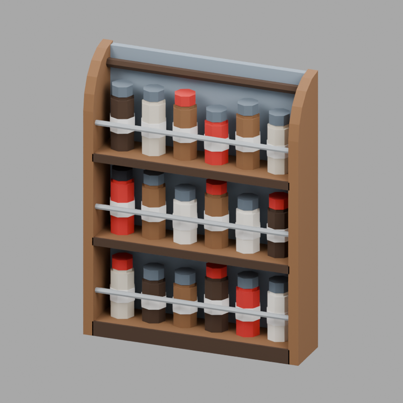
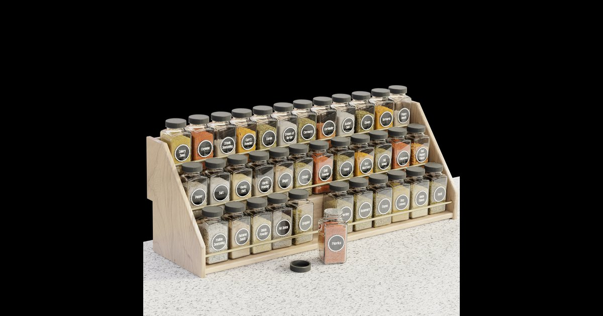

# 三层调料架与配套调料罐素材

2026-11-17。为囤囤鼠搜集放在冰箱旁边的三层调料架，点击查看调料情况。免费优先；本轮只整理素材，不修改 App 或已有冰箱设计稿。用户尚未选定具体素材。

## A：优先推荐，同冰箱系列的三层架

[Spice racks 来源与在线预览](https://1designtool.com/3d/models/kitchen-spice-racks) · [GLB 下载](https://assets.stoicsoft.com/1designtool/3d/models/kitchen-spice-racks/507a7244aa/model.glb) · [许可](https://1designtool.com/3d/license)

- 和已选的 Oven and fridge doors 同属 1DesignTool Kitchen 系列，使用同一命名色板；风格最容易配套。
- 实际文件 209,220 字节、2,564 三角面、27 网格；三层，每层六罐，共十八罐；无动画。约宽 38、高 50、深 10 cm。
- 免费用于个人及商业 App，可修改、拆分和制作渲染，无需署名。禁止将源模型单独再分发，因此原 GLB 仅下载至本机研究目录，不放入仓库。
- 罐子已经配套，但按 `jars_1`／`jars_2`／`jars_3` 分组，再按材质合并；**不是十八个独立罐对象**。整个架子作为点击入口可以使用；若逐罐控制、隐藏或取出，需要先拆分几何或另外制作独立罐。白色标签是无文字色带。
- 架子默认是台面摆放或挂墙尺度；放在冰箱旁，建议挂墙或放在小台面上。小台面是设计建议，不是模型自带部件或已确认需求。

## B：写实备选，木制三层阶梯架＋整套罐子

[Wood Spice Rack and Spices](https://www.blendkit.com/asset-gallery-detail/a3f3affb-1549-486a-bbfc-ba516709ef5a/) · [发布平台许可](https://www.blendkit.com/docs/licenses/)

- 作者 Doug Teeples。页面标注 Free、Royalty free；预览能看到三层阶梯架、配套玻璃罐、散放罐及盖子。
- 页面标注约 20.9 MiB、949,158 多边形，明显比 A 重；若采用，建议离线渲染或先减面。写实木纹、玻璃和英文标签也需要与现有冰箱风格协调。
- 尚未下载源文件；罐子能否逐个拆分、实际文件格式与移动端效果尚未验证。Free 不等于 CC0，不将其作为可自由再分发的模型库资源。下载按平台 Get this model 流程办理，本轮未登录或安装插件。

## C：独立调料罐补充素材

[Spice Turn - Kitchen Organizer](https://www.innerscene.com/tools/library/3d-parts/spice-turn-kitchen-organizer-7697fde2) · [本地 GLB](spice-carousel.glb) · [许可记录](spice-carousel-LICENSE.txt)

- Innerscene 原创，CC0，免费商用、修改与再分发，无需署名。
- 本体是**单层圆形六罐托盘**，不能代替三层架；主要作为独立罐的备选。实际文件 917,480 字节，罐身、底部、盖子分别命名为独立节点，可组合成单罐。
- 罐子是空罐，内容物、标签、颜色需要另做。与 A 并非同系列，需统一材质和尺寸，尚未做替换组合。
- 已导入 Blender 并渲染检查；透明玻璃的表现依赖环境、材质与渲染器，尚未做 Android 验证。

## 排除的另一款

[tabitown 的 Spice Rack](https://sketchfab.com/3d-models/spice-rack-9b5633559e414cfba5fc055c53cc298b) 免费、CC BY 4.0，需署名。原作者预览是两排球形瓶＋抽屉，并非三层，因此不列入推荐。仅检查公开元数据及[作者预览](sketchfab-spice-rack.jpg)，未下载源文件。

## 后续设计方向

- 用户已提出：三层调料架放在冰箱旁，点击查看调料情况。
- 建议先用 A 自带罐子作为场景装饰，整个架子作为入口；点击后的列表内容、调料余量表达、退出方式待一起设计。
- 模型里的十八罐不是家庭实际库存，不据此创建调料记录或推算剩余量；没有现货的调料是否在架上隐藏仍待讨论。
- 本轮没有修改 App、库存数据、冰箱交互或上次设计稿。

[候选对比图](comparison.svg.png) · [出处清单](sources.json) · [实际文件结构与校验值](model-inspection.json)。A、C 已检查实际文件并在 Blender 5.2.3 渲染；B 仅检查来源页与预览。未做 Android 设备或性能验证。
