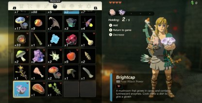
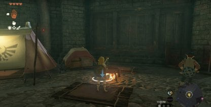
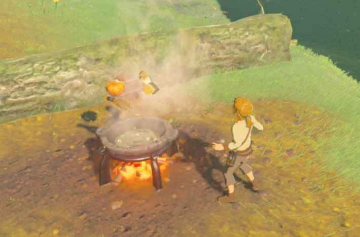
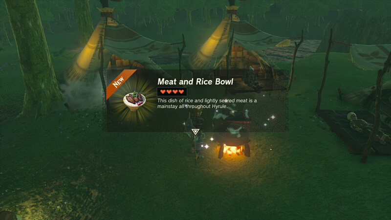
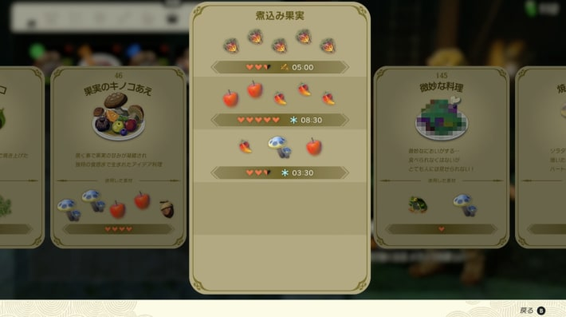
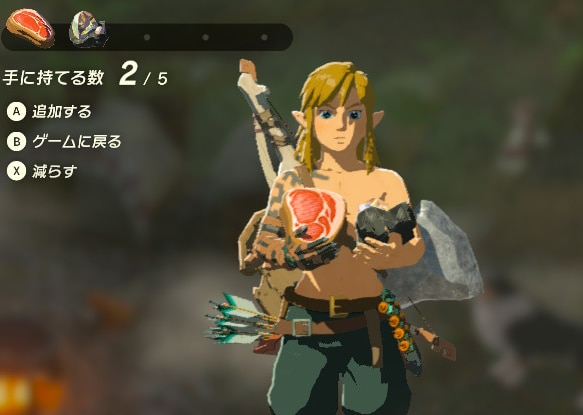

# 王国之泪烹饪画面音效与文本参考

收集日期：2026-11-17。用于 COOKX 烹饪体验讨论，包含 6 张画面、13 条官方音频曲目索引、视频入口及少量文本样例。素材均标明出处，作为研究参考保存，不代表已选为 App 内使用的资源。

## 画面

### 选择材料

可观察材料网格、选中物品说明、已选材料横条、数量和角色手持预览。原图为英文版。

[来源页面 GameWith](https://gamewith.net/zelda-totk/article/show/38906) · [原图](https://img.gamewith.net/img/9e792c22da6a9810d6cd4abe52712a7a.jpg)

### 锅前操作

锅具融入场景，角色手持材料站在锅前。该图尺寸较小，适合看构图，不适合核对按钮文字。

[来源页面 GameWith](https://gamewith.net/zelda-totk/article/show/38906) · [原图](https://img.gamewith.net/img/7a9219dc04bf505ce334b8a943c9f970.jpg)

### 烹饪动画

静帧呈现食材弹起、蒸汽和角色姿态；动作节奏与声音需结合下方视频。来源页面将此图放在大成功章节，但该静帧本身不能证明大成功状态。

[来源页面 GameWith](https://gamewith.net/zelda-totk/article/show/38906) · [原图](https://img.gamewith.jp/img/33527283ceead4f8c9f8f1623f9afd3e.jpg)

### 出锅结果

画面中料理图标、放射光芒、名称、回复心心、描述和 NEW 标记集中出现，后方仍保留游戏场景。

[来源页面 The Nerd Stash](https://thenerdstash.com/how-to-complete-gourmets-gone-missing-in-zelda-tears-of-the-kingdom/) · [原图](https://image.thenerdstash.com/2023/05/gourmets-gone-missing-final.jpg)

### 配方与制作履历

日文卡片中央展示同一道料理的多种材料组合、回复量和效果时间，侧面可见其他料理及失败料理的像素化图标。这里的效果时间不是现实做菜所需的时间。

[来源页面 GameWith](https://gamewith.net/zelda-totk/article/show/38906) · [原图](https://img.gamewith.jp/img/ee9198875f703276125352e3759e1479.png)

### 不相容材料的选择状态

日文界面中选择了肉与矿石。此图展示选择状态，不是失败出锅截图；失败料理图标可看上一张配方卡右侧。

[来源页面 GameWith](https://gamewith.net/zelda-totk/article/show/38906) · [原图](https://img.gamewith.jp/img/300c016a4a21fd3b3f62b16e90f8b284.png)

## 音效与音乐

下表的曲名、碟号和轨号均以[日本哥伦比亚官方原声目录](https://columbia.jp/zelda/)中《王国之泪》的 DISC-9 为准。该网页同时列出其他作品，定位时请看页面最前面的《王国之泪》部分。

| 碟号与轨号 | 官方日文名称 | 中文索引 |
| --- | --- | --- |
| 9-39 | 料理失敗 | 料理失败 |
| 9-40 | 料理成功 | 料理成功 |
| 9-41 | 料理大成功 | 料理大成功 |
| 9-47 | リンクのハミング 1 | 林克哼唱 1 |
| 9-48 | リンクのハミング 2 | 林克哼唱 2 |
| 9-49 | リンクのハミング 3 | 林克哼唱 3 |
| 9-50 | リンクのハミング 4 | 林克哼唱 4 |
| 9-51 | リンクのハミング 5 | 林克哼唱 5 |
| 9-52 | リンクのハミング 6 | 林克哼唱 6 |
| 9-53 | リンクのハミング 7 | 林克哼唱 7 |
| 9-54 | リンクのハミング 8 | 林克哼唱 8 |
| 9-55 | リンクのハミング 9 | 林克哼唱 9 |
| 9-56 | リンクのハミング 10 | 林克哼唱 10 |

### 播放入口

- [B 站做料理整合音频 第 55 P](https://www.bilibili.com/video/BV1xL41167RV/?p=55)：已通过平台元数据核对分 P 标题“做料理（整合）”，时长 74 秒。它是上传者的游戏音频整合，不能将其分 P 编号当作官方 OST 轨号；未逐段试听，也未认定其包含上表全部曲目。
- [林克烹饪哼唱实机视频 SammiiCake Gaming](https://www.youtube.com/watch?v=B7J9xr3KjXM)：用于观看和听辨烹饪中的哼唱；已找到发布信息，本轮未播放核验，也不将其认定为 10 首完整合集。
- [任天堂烹饪介绍](https://www.nintendo.com/en-gb/News/2023/May/12-spoiler-free-tips-for-your-The-Legend-of-Zelda-Tears-of-the-Kingdom-adventure-2385024.html)：第 7 节 Get cooking some delicious meals 包含嵌入视频；[对应视频入口](https://www.youtube.com/watch?v=7mJxB9CJs2c)。

当前选用 [料理大成功音频](cooking-great-success.mp3)，对应 DISC-9 第 41 轨，替代此前的普通成功音效。原 [料理成功音频](cooking-success.mp3) 保留作对照。下载出处与 SHA-256 见 `sources.json`。其他曲目仍仅收集入口。锅内烹饪声、投料声和界面提示声未分离。

## 文本

### 界面短文案

| 原文或视觉标记 | 位置 | 含义 |
| --- | --- | --- |
| Holding: 2/5 | 英文选材截图 | 已手持 2 项，上限 5 项 |
| Add | 英文选材截图 | 增加材料 |
| Return to game | 英文选材截图 | 返回游戏 |
| Decrease | 英文选材截图 | 减少材料 |
| NEW | 英文出锅截图 | 新获得料理标记 |
| Meat and Rice Bowl | 英文出锅截图 | 料理名称；中文请另按游戏语言版本核对 |

以上文字来自本地保存并查看的截图，中文含义为本资料的解释，不冒充简体中文版游戏按钮原文。

### 中文料理名称与描述

[Kiranico 简体中文料理数据库](https://zelda.kiranico.com/zh/totk/data/food)提供料理图标、名称与描述，可用于查阅文案。以下仅摘录一段短语，其余描述做概括。

| 名称 | 文本参考 | 表达特点 |
| --- | --- | --- |
| 烤蘑菇串 | 原文短语：“充满蘑菇香气的简单烤串” | 先交代食材香气与简易做法 |
| 番茄披萨 | 概括：描述番茄与融化起司的风味 | 用具体食材建立画面 |
| 野菜牛奶粥 | 概括：通过温暖、容易入口的感受介绍料理 | 把食物与用餐情境联系起来 |

[王国之泪料理食谱展示视频](https://www.bilibili.com/video/BV13g4y1c7FW/)可作为中文画面候选入口；平台元数据可读取，但本轮未逐帧核对语言和文案。网络文章常把失败料理译名混写，未核对前不把某个译名认定为指定语言版本原文。

## 对 COOKX 的讨论参考

以下为设计观察，不是已确认的产品需求：

- 选材后立即展示所选内容，方便核对和撤回。
- 制作完成时集中展示成品，用短促反馈形成完成感。
- 同一道菜保留不同制作组合和效果的记录方式，可用于讨论 COOKX 制作历史。
- 文案侧重食材、口感和经验，保持简洁。

已参考出锅卡片制作 COOKX UI 设计稿，本轮不修改 App 代码。原游戏画面与声音不属于 COOKX 自有素材，卡片图形使用项目现有插画。

## 最终设计交接

[出锅结果设计与音频交接](../../designs/cooking-result/README.md)汇总最终 SVG、PNG、料理大成功接获得物品的裁剪音频、播放时序与交互规则。实现时以该交接包的选用音频和时序为准。
